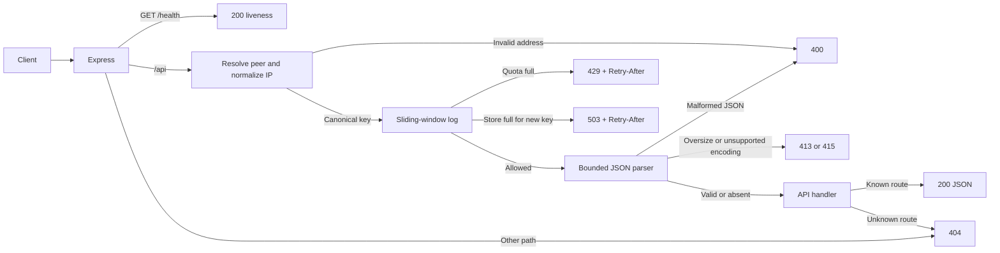

# Architecture and design decisions

## ADR 001 — Exact acceptance log in one process

The limiter stores one timestamp per admitted request and applies the interval `(t - windowMs, t]`. A timestamp expires when its age is at least `windowMs`. Quota decisions, accounting and remaining slots all come from the same log. A rejected attempt creates no timestamp because retries should leave the next available slot at its original time.

This log avoids the boundary burst of fixed counters and estimation error of interpolated sliding counters. A synchronous in-process Map keeps the state transition within one event-loop turn. Parallel HTTP handlers in one process cannot interleave between reading and recording a decision. Each worker, container and replica owns its own store.

Production samples come from monotonic `performance.now()`, which measures elapsed milliseconds independent of wall-clock adjustments. The injected clock supports fractional samples and must return finite nonnegative values through `Number.MAX_SAFE_INTEGER`. The limiter freezes at the previous high-water mark during a regression and resumes expiration when time advances. Invalid values throw before changing state. A forward jump expires entries according to the elapsed interval. State and the clock watermark are process-local.

## ADR 002 — Bound state and preserve active buckets

Each array stores up to Q timestamps, and the Map tracks up to K keys. The constructor and environment validation cap the product at 1,000,000. A retained bucket can contain expired prefix entries until its next check. A periodic sweep, scheduled at the smaller of one window or 60 seconds, reclaims fully expired idle buckets.

A doubly linked list orders the same buckets by their latest accepted request. The earliest bucket expires first because the window is the same for every key and accepted times are nondecreasing. An acceptance moves the bucket to the end. A direct pointer to the oldest bucket avoids the cost of restarting Map iteration after successive deletions. At capacity, a new IP reclaims one expired oldest bucket or receives `503` with a short retry hint. Reclaiming active buckets would discard the history that enforces the quota. Existing keys remain eligible for normal quota decisions while the store is full.

| Operation                                                                  | Expected cost                                |
| -------------------------------------------------------------------------- | -------------------------------------------- |
| Check without expiry, including quota rejection                            | Amortized O(1)                               |
| Prune and compact one key's timestamp array                                | O(Q) worst case                              |
| Reject a new key at capacity or reclaim one fully expired bucket on demand | Amortized O(1)                               |
| Sweep E fully expired buckets                                              | Amortized O(E + 1), bounded by K             |
| Retained state                                                             | O(K + KQ), plus per-request runtime overhead |

Deletion makes expired arrays eligible for garbage collection. Allocation and Map resizing, the cost of a large synchronous sweep, Node heap usage, and concurrent HTTP traffic still depend on load and the runtime. The budget limits logical slots.

## ADR 003 — Resolve identity at the network trust boundary

Direct mode uses `req.ip` via Express with proxy trust disabled. Proxy mode compiles an allowlist from literal IP addresses and CIDRs, applying the same strict normalization to every hop tested for trust. IPv4 and IPv6 subnet matching use separate family lists. The app walks the request chain through known proxies from the socket toward the client. The first untrusted address is the client identity. A selected invalid address fails with `400` before store access.

Equivalent IPv6 spellings collapse to the same key. IPv4-mapped IPv6 and native IPv4 share a key. Compatible-style IPv6 addresses and all other genuine IPv6 hosts retain IPv6 identity. IPv6 prefix aggregation would change the quota policy and is outside this design. [Trust assumptions and deployment responsibilities](SECURITY.md)

## ADR 004 — Keep liveness independent of quota

`GET /health` reports process liveness with a constant payload and avoids the parser and quota store. It remains available when an API quota or the store itself is exhausted. All `/api` requests share the IP quota. Limiting before parsing protects CPU and limits accepted traffic across routes. The JSON parser caps buffered JSON at 16 KiB and accepts identity encoding. Node applies 10-second header and 30-second request deadlines separately from application processing.

On `SIGINT` or `SIGTERM`, the server stops sweeping and closes the listener. Active requests have up to ten seconds to finish. Finished keep-alive connections are reclaimed during the drain. On timeout the service closes remaining HTTP connections and exits nonzero. Repeated signals share the in-progress shutdown operation.

## Shared-store migration

Retain canonical keys and the HTTP contract. Store accepted timestamps as scores in a per-key Redis sorted set. In one Lua script or Redis Function, read a consistent server time, guard the per-key time watermark, delete scores through `now - windowMs` inclusively, check the cardinality and add a uniquely identified member only when admitted. Requests at the same timestamp need distinct member IDs. Derive reset from the oldest surviving score and set TTL from the latest acceptance. Keep all keys touched by the per-client operation in the same cluster slot.

Define behavior during datastore outages, failovers and operation retries before rollout. Use an idempotency key if retrying an uncertain outcome could double-charge a request. If a global cap on tracked IPs remains a requirement, account for it separately and define how it is enforced across shards. Verify failure behavior, latency and capacity with the real topology.
